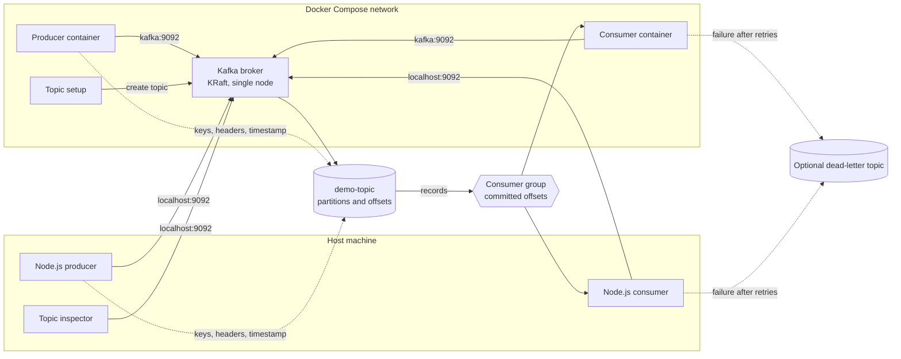

# Architecture

The demo has two ways to reach Kafka: applications running on the host use the external listener at `localhost:9092`, while Compose services use the Docker-network listener at `kafka:9092`. Both routes reach the same broker and the same topic.

## Reading the diagram

- **Producer:** sends records. Kafka assigns a partition and offset unless the producer supplies a partition. A key normally influences partition selection, while headers and timestamps travel with the record.
- **Broker:** stores records in `demo-topic`. This local demo uses one Kafka node, so the Compose setup uses replication factor `1`; that is a learning-friendly setup, not production fault tolerance.
- **Topic:** is divided into partitions. Ordering is guaranteed within one partition, not across the entire topic.
- **Consumer group:** gives each partition to one group member at a time and stores committed offsets. A different group can read the same records independently.
- **Dead-letter topic:** is optional. When Lesson 5's consumer exhausts its application retries, it can publish the failed record and failure metadata to a separate topic.
- **Topic inspector:** reads beginning and end offsets without consuming application records. It helps compare the broker's retained range with a consumer's committed position.

## Host and container addresses

Kafka advertises two addresses in Compose:

| Application location | Broker address   | Why                                                   |
| -------------------- | ---------------- | ----------------------------------------------------- |
| Host process         | `localhost:9092` | The port is published from the container to the host. |
| Compose service      | `kafka:9092`     | Docker's internal DNS resolves the service name.      |

Using `localhost:9092` inside a container would point back to that container, not to Kafka. Conversely, `kafka:9092` is not normally resolvable by a process running directly on the host.

## Related code and lessons

- The broker listeners and topic setup are defined in `docker-compose.yml`.
- The producer path is implemented in `src/producer.js`; the consumer path is implemented in `src/consumer.js`.
- Topic offset inspection is implemented in `src/topic-admin.js`.
- [Lesson 1](lesson-01-basics.md) follows one record through the basic path.
- [Lesson 2](lesson-02-groups-and-offsets.md) explores groups, committed offsets, and replay.
- [Lesson 3](lesson-03-partitions-and-ordering.md) explores partitions, keys, ordering, and parallel consumers.
- [Lesson 4](lesson-04-headers-timestamps-and-inspection.md) explores record metadata and offset ranges.
- [Lesson 5](lesson-05-failures-retries-and-dead-letters.md) explores retries and dead-letter routing.
- [Lesson 6](lesson-06-acknowledgments-retries-and-idempotence.md) explores producer delivery settings.
